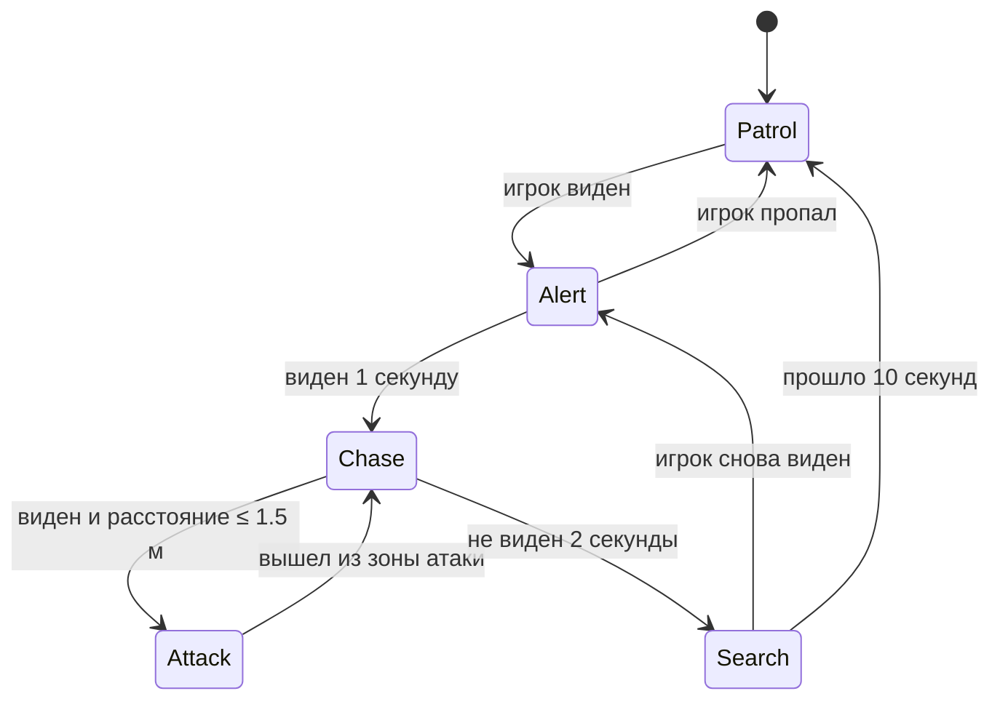
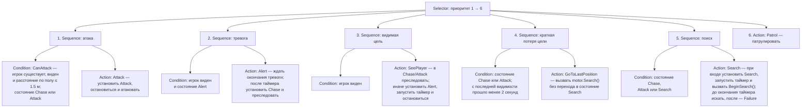

# Диаграммы поведения

## FSM

## Behavior Tree

Схема соответствует текущей реализации `GuardBT.cs`. Корневой Selector каждый кадр проверяет ветви в порядке 1–6 и останавливается на первой, вернувшей Success или Running. Sequence выполняет действие только после успешной проверки условия.

Дети каждого Sequence выполняются слева направо в порядке «Condition → Action». Все действия возвращают Running, кроме Search после окончания таймера: он возвращает Failure, поэтому Selector в том же кадре переходит к Patrol.

Перед обходом дерева видимая цель обновляет `lastSeenTime` и последнюю известную позицию. Поэтому ветвь 4 фактически выполняется после потери видимости: при видимой цели раньше срабатывает одна из ветвей 1–3. Таймеры по умолчанию: тревога — 1 секунда, потеря цели — 2 секунды, поиск — 10 секунд; значения настраиваются в инспекторе.

Ветка GoToLastPosition на схеме намеренно показывает фактический вызов `motor.Search()`. Отдельного действия движения только к последней известной позиции в текущем коде нет; исправление схемы не исправляет эту особенность реализации.
