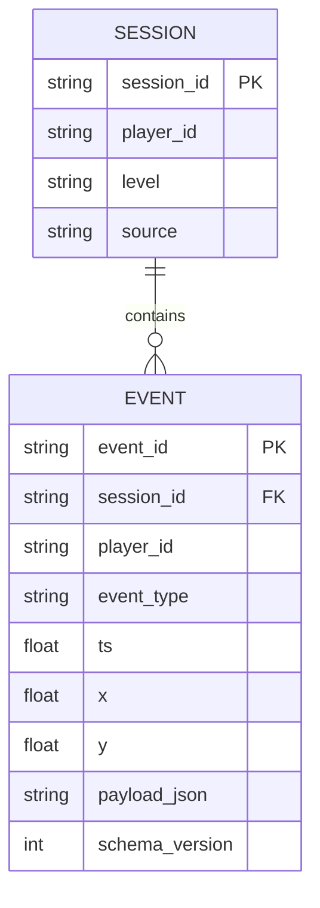

# Схема событий ЛР № 2

Сервер принимает массив JSON по `POST /events`. Время `ts` задаётся в секундах Unix UTC.
Каждый запуск или повтор уровня создаёт новый `session_id`; `player_id` сохраняется между сессиями.

| Поле | Тип | Назначение |
|---|---|---|
| schema_version | integer | Версия схемы, сейчас 1 |
| event_id | string | Уникальный идентификатор события; повторная доставка не создаёт дубликат |
| session_id | string | Идентификатор сессии |
| player_id | string | Псевдоним игрока, без личных данных |
| event_type | string | Один из пяти типов в таблице ниже |
| ts | number | Неотрицательное конечное значение времени Unix UTC |
| level | string | L1 или L2; в одной сессии не меняется |
| source | string | unity для событий игры, simulation для учебной выборки |
| x, y | number/null | Координаты по полу в пределах [-10, 10]; x = Unity X, y = Unity Z |
| payload | object | Дополнительные сведения о событии |

| Событие | Когда записывается | Координаты | payload |
|---|---|---|---|
| session_start | Старт или перезапуск уровня | Не обязательны | Пустой объект |
| death | Здоровье стало равным нулю | Обязательны, до возрождения | cause: guard |
| checkpoint | Первое попадание в радиус контрольной точки | Обязательны | Пустой объект |
| level_complete | Игрок дошёл до выхода после контрольной точки | Обязательны | time_s: время прохождения |
| session_end | Выход, перезапуск, завершение уровня или остановка Play | Не обязательны | reason: quit/restart/complete/stop |

Unity записывает неиспользуемые числовые поля как 0, строковые как пустые строки. Для расчётов координат
выбираются только события `death`, поэтому нули у начала и конца сессии не попадают на карту.

```json
{
  "schema_version": 1,
  "event_id": "event-001",
  "session_id": "session-001",
  "player_id": "player-01",
  "event_type": "death",
  "ts": 1791294590.698,
  "level": "L1",
  "source": "unity",
  "x": 6.0,
  "y": 0.0,
  "payload": {"cause": "guard"}
}
```

## Хранение и доставка



Пакет содержит от 1 до 500 событий. Неверная схема возвращает HTTP 422; конфликт идентификатора
или принадлежности сессии — HTTP 409. Запись пакета выполняется одной транзакцией.
HTTP 202 возвращает количество новых и повторных событий. Индексы ускоряют поиск по сессии/времени и типу/уровню.

Событие сначала попадает в JSONL, затем в HTTP-буфер. После подтверждения отправленный пакет удаляется
из буфера. При недоступном сервере файл остаётся пригодным для импорта; при закрытии Unity нельзя
полагаться на завершение сетевой корутины, поэтому конечное событие также сохраняется локально.
