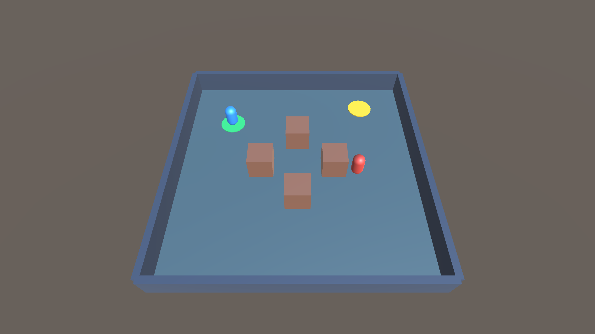
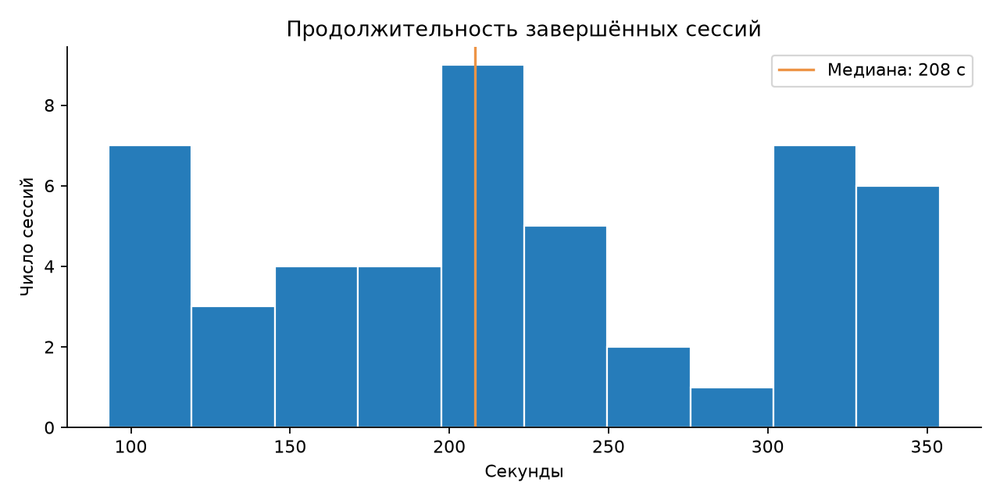
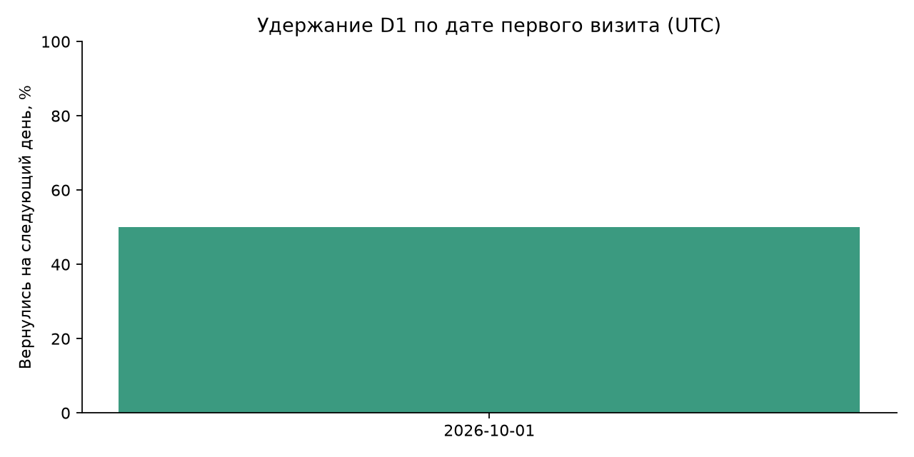
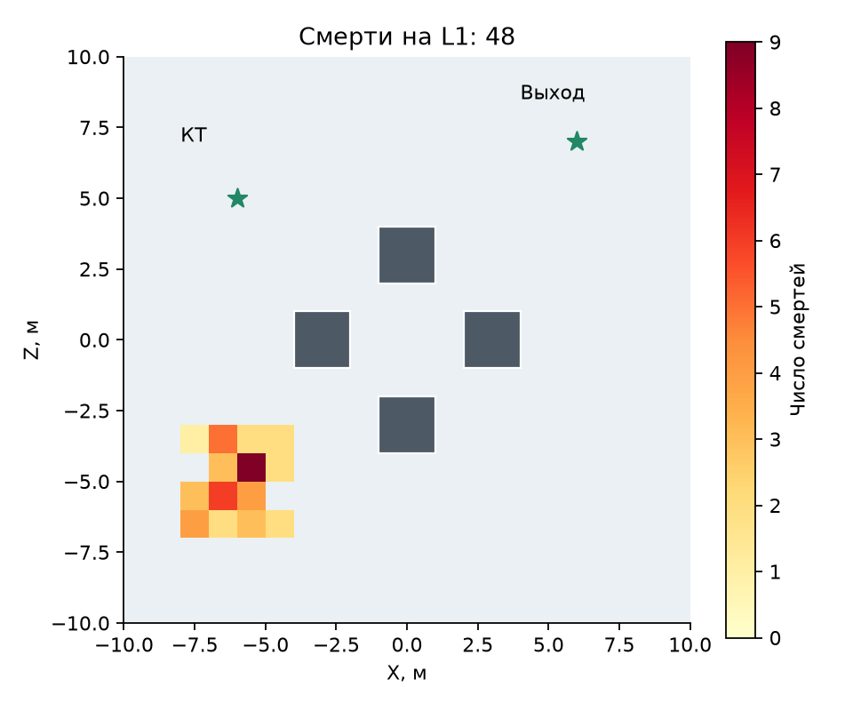
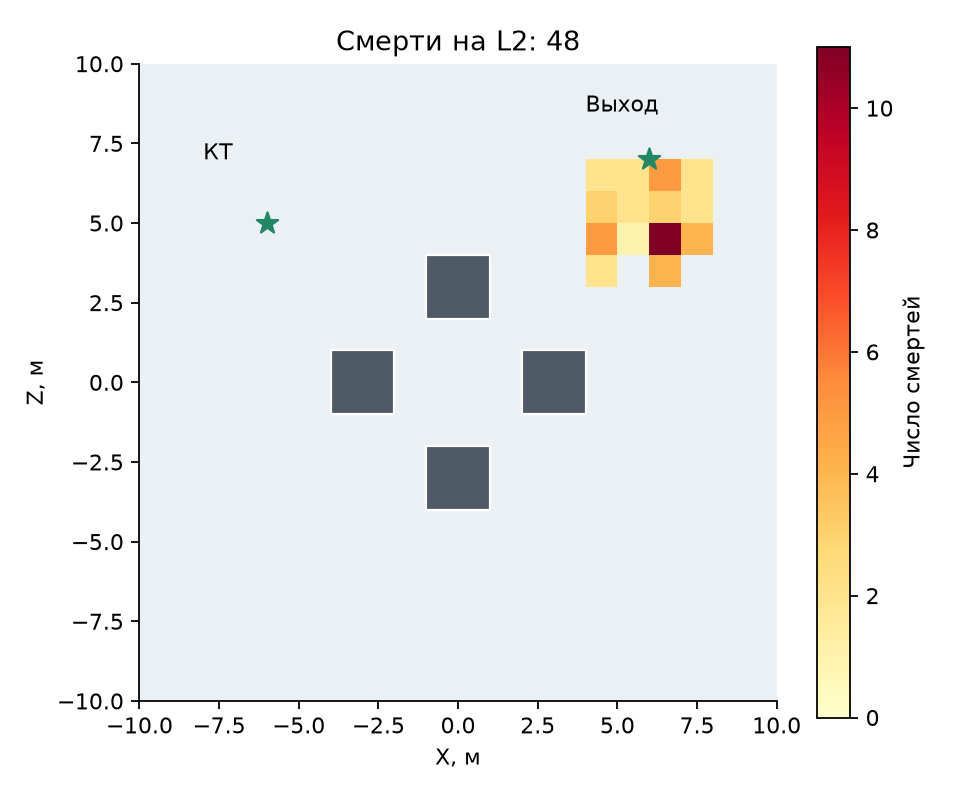
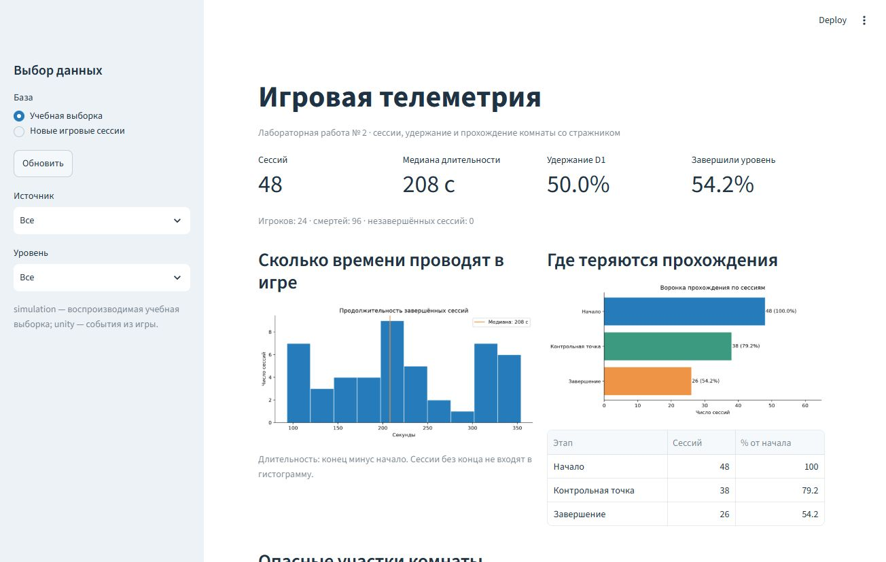
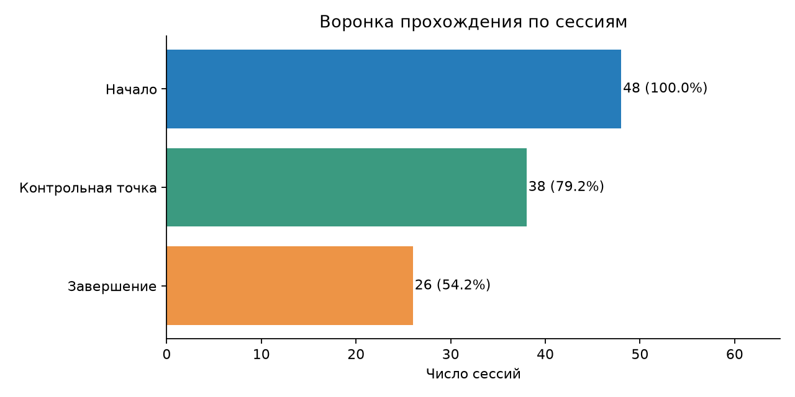

# Отчёт по лабораторной работе № 2

# Лабораторная работа № 2

## Сбор и анализ игровой телеметрии

Дисциплина: Игровой искусственный интеллект. Направление 09.03.01, профиль «Разработка игровых и XR-приложений».

Студент: Печенов Владимир Владимирович

Группа: ИВТ-465

Преподаватель: Колесников Н. С.

Дата: 06.10.2026

## 1. Цель и постановка задачи

Организовать сбор событий игрового клиента, сохранить их в базе и получить метрики, позволяющие описать прохождение уровня и возвращение игроков.

Требования: клиентский логгер; база с не менее чем 20 сессиями; расчёт длительности, удержания D1, тепловой карты смертей и конверсии; дашборд с не менее чем тремя визуализациями. Определения метрик приведены в README.

Реализация использует Unity 6000.3.9f1, C#, Python 3.14, FastAPI, SQLite, pandas, matplotlib и Streamlit. Игровая основа - комната со стражником из первой работы.

Материалы находятся в ветке lab02-telemetry существующего репозитория. Сцена Lab01 также сохранена; новая сцена Lab02 содержит игровой сценарий для сбора телеметрии.

## 2. Архитектура и события

Поток данных: Unity → локальный JSONL и HTTP POST → FastAPI → SQLite → pandas → графики и Streamlit. Сервер записывает новые игровые данные в live.db; готовая учебная база telemetry.db хранится отдельно.

| Событие | Условие записи | Дополнительные поля |
| --- | --- | --- |
| session_start | Запуск или перезапуск уровня | level, source |
| death | Три удара стражника | x, y, cause |
| checkpoint | Первое достижение зелёного диска | x, y |
| level_complete | Выход после контрольной точки | x, y, time_s |
| session_end | Завершение, выход или перезапуск | reason |

Каждое событие содержит event_id, session_id, player_id, ts, level, source и schema_version. ts - секунды Unix UTC. Координаты комнаты представлены парой x/y, где y соответствует оси Z Unity. Идентификатор игрока сохраняется между сессиями.

Таблица sessions хранит принадлежность сессии игроку, уровню и источнику; events содержит события и внешнюю ссылку на сессию. event_id является первичным ключом. Индексы построены по сессии/времени и типу/уровню.

Логгер сохраняет событие до сетевого запроса; буфер удаляется только после ответа сервера. При повторной доставке event_id предотвращает двойной учёт. Конфликт содержания откатывает весь пакет. При остановке игры локальный файл позволяет восстановить конечное событие.

```csharp
ts = DateTimeOffset.UtcNow.ToUnixTimeMilliseconds() / 1000.0;
x = position.x; y = position.z;
File.AppendAllText(FilePath, JsonUtility.ToJson(item) + "\n");
pending.Add(item);
```

## 3. Игровая сцена и проверка сбора



Игрок управляется WASD. Зелёный диск расположен в (-6; 5), выход в (6; 7). После трёх ударов записывается смерть и происходит возрождение. Выход доступен после контрольной точки. R начинает новую сессию, Esc завершает текущую.

Уровни используют одинаковую геометрию: L1 - FSM и скорость 3,5 м/с; L2 - BT и скорость 4,2 м/с. Координаты препятствий совпадают со схемой тепловой карты.

Проверка в Unity дала 15 событий двух завершённых сессий. События доставлены по HTTP и сохранены в SQLite; JSONL-копия находится в data/unity-capture.jsonl.

| Тип | Количество |
| --- | --- |
| session_start | 2 |
| death | 7 |
| checkpoint | 2 |
| level_complete | 2 |
| session_end | 2 |

Игровые события имеют source=unity. Учебная выборка имеет source=simulation и фиксированный seed 42; она проверяет расчёты на 48 сессиях 24 игроков за 1-4 октября 2026 года. Эти два источника не смешиваются при подготовке результатов ниже.

## 4. Длительность и удержание

Длительность = ts(session_end) - ts(session_start). Сессии без границы конца и отрицательные длительности исключаются. В учебной базе все 48 сессий завершены; медиана составляет 208 с.



D1 - доля игроков, имеющих сессию в следующий календарный день UTC после первого визита. Новые игроки последнего дня наблюдения исключаются из знаменателя. Повторный визит в тот же день или только на D2 не считается D1.



Из 24 игроков 12 возвращаются на следующий день: D1 = 12/24 = 50%. Все 24 имеют повторные сессии, поэтому простой подсчёт игроков с двумя входами дал бы неверный результат 100%.

## 5. Тепловые карты и дашборд

Тепловая карта - 2D-гистограмма смертей в диапазоне [-10; 10] по двум осям, 20 × 20 ячеек. Каждая ячейка соответствует 1 × 1 м. Для L1 и L2 строятся отдельные карты поверх одинаковой схемы комнаты.





На каждом уровне записано 48 смертей. Учебная выборка размещает их в открытых участках: L1 около (-6; -5), L2 около (6; 5). Карты позволяют проверить преобразование координат и разделение уровней. Для выводов о реальном балансе нужны дополнительные прохождения игроков.

Дашборд содержит гистограмму длительности, воронку, тепловые карты и график D1. Фильтры выбирают базу, источник и уровень. При изменении фильтра все показатели пересчитываются; события доступны для просмотра и выгрузки CSV.



## 6. Конверсия, проверки и выводы



Воронка требует хронологического порядка: начало → checkpoint → завершение. Каждая сессия считается один раз на шаге. Из 48 сессий контрольной точки достигли 38 (79,2%), выхода - 26 (54,2%). Между контрольной точкой и выходом потеряно 12 из 38 сессий, или 31,6%.

Проверки Python: 16 тестов пройдены. Проверены границы длительности, календарный D1, порядок воронки, повторная доставка, откат конфликтующего пакета, неверные поля и фильтрация дашборда. В Unity подтверждены события всех пяти типов на L1/L2 и доставка в SQLite.

Получена полная цепочка сбора и анализа. Данные и графики воспроизводятся из JSONL; сервер допускает повторную доставку без искажения метрик. Учебная выборка проверяет расчёты, а игровые сессии подтверждают работу логгера. Для улучшения уровня следует сравнить потери между этапами и расположение смертей на расширенной игровой выборке.

## 7. Источники и материалы

1. Шаблон ЛР № 2: https://github.com/kolesnikov-vstu-gameai/lab02-telemetry

2. SQLite: https://www.sqlite.org/lang_transaction.html

3. pandas: https://pandas.pydata.org/docs/

4. FastAPI: https://fastapi.tiangolo.com/

5. Streamlit: https://docs.streamlit.io/

Репозиторий: https://github.com/VladimirPechenov/III_lab1/tree/lab02-telemetry. Исходные события: data/events.jsonl; результаты: results/; схема: docs/event_schema.md.
